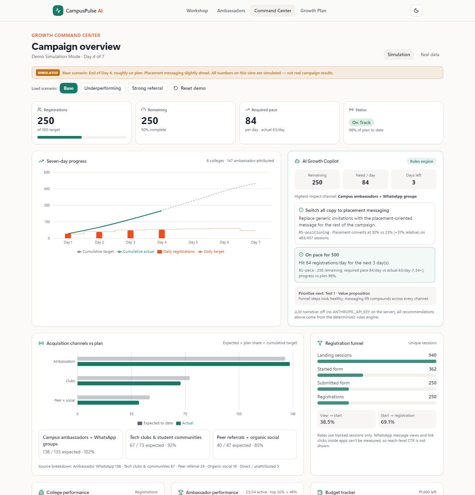
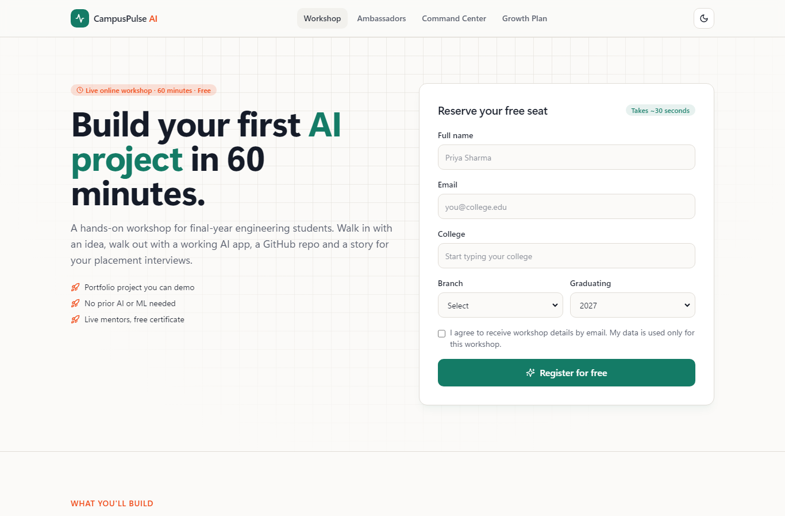
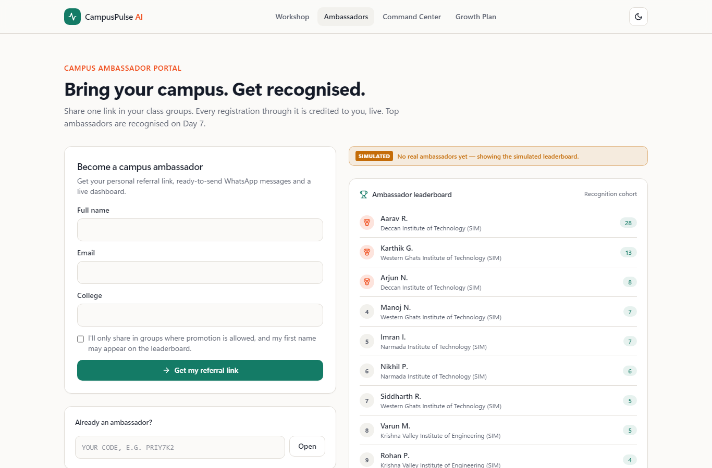
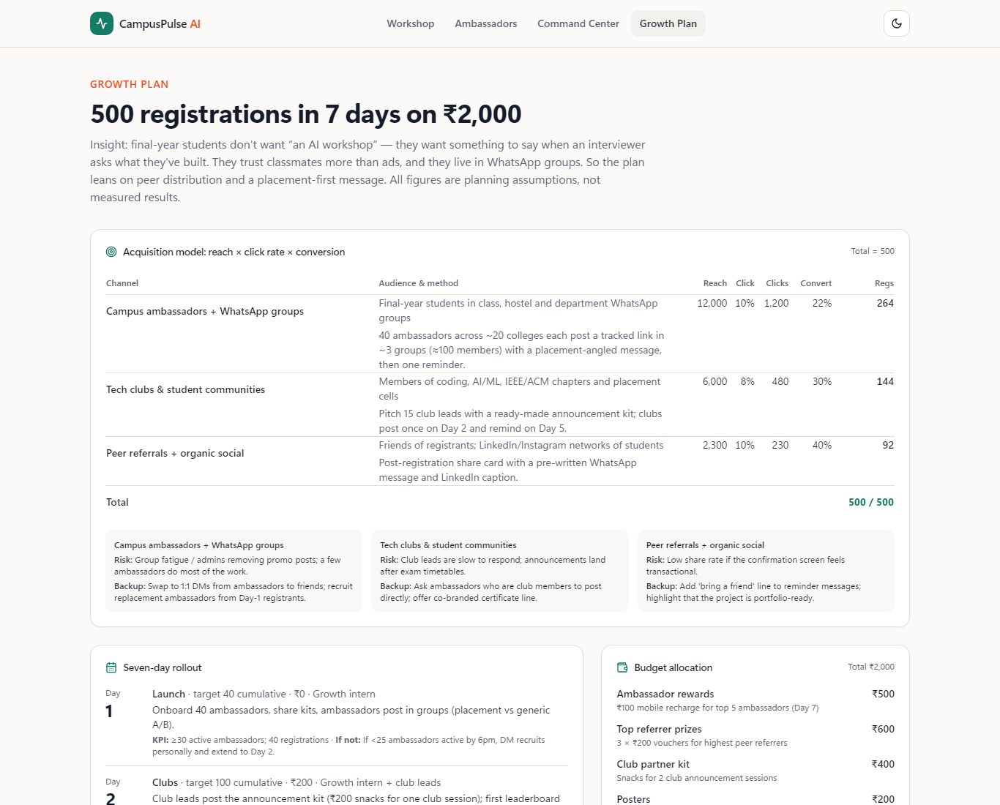
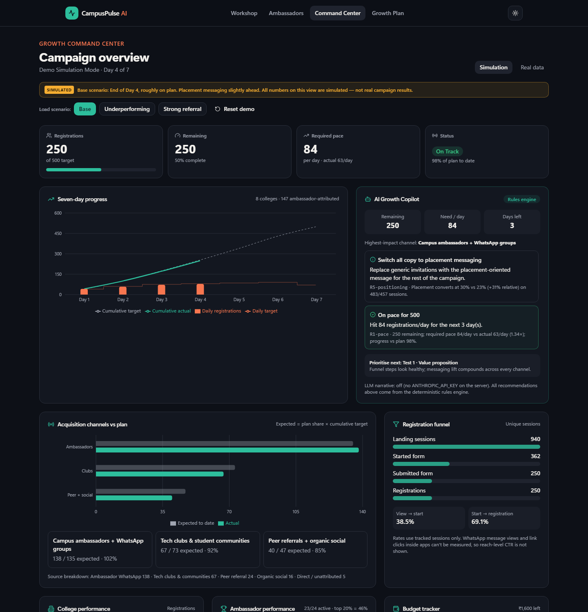
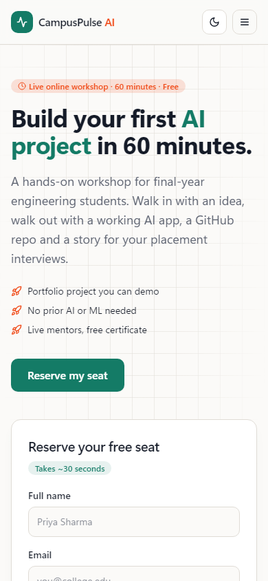
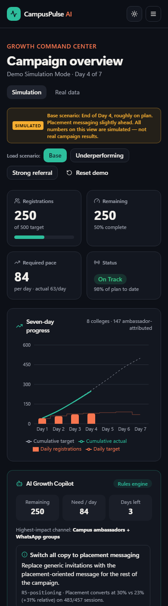

# CampusPulse AI — The Student Growth & Referral Engine

> Turn student communities into measurable workshop registrations.

Built for the **NxtWave Growth Intern Round 1 Challenge**: get 500 final-year engineering students to register for *"Build Your First AI Project in 60 Minutes"* in 7 days with ₹2,000. **This is a simulation.** No students were contacted, and every demo number is labelled **SIMULATED**.



## What's inside

| Experience | Route | What works |
|---|---|---|
| Student registration | `/` | Workshop landing page, mobile-first form, college/branch selection, `?ref=` attribution, confirmation ID, duplicate protection (normalized email + DB unique constraint), share card, A/B variants (`v=placement\|generic`, `form=short\|long`) |
| Ambassador portal | `/ambassador`, `/ambassador/[code]` | Onboarding → unique code, tracked links, WhatsApp-ready A/B + reminder messages, copy/share, personal dashboard (count, rank, branches), ambassador + college leaderboards |
| Growth Command Center | `/dashboard` | KPIs, 7-day trend vs target, channel vs plan with underperformance alerts, funnel, colleges, ambassadors, budget, experiments, Demo Simulation Mode (3 scenarios + reset), locked real-data view |
| AI Growth Copilot | `/dashboard`, `POST /api/copilot` | Deterministic rules engine with rule IDs and the numbers behind each recommendation; optional, labelled LLM summary |
| Growth plan | `/plan` | Funnel model (reach × CTR × conversion = 500), 7-day timeline, ₹2,000 budget, three experiments |

## Quick start

```bash
npm install
cp .env.example .env
npm run setup          # prisma generate + create SQLite DB + load the base demo scenario
npm run dev            # http://localhost:3000
```

Load a different demo scenario from the dashboard buttons, or with `npm run db:seed -- underperforming` (also `base`, `referral`).

## Architecture

```
app/                    Next.js 14 App Router (server components + route handlers)
  page.tsx              landing + registration
  ambassador/           portal + personal dashboard
  dashboard/            Command Center + Copilot
  plan/                 growth plan
  api/                  register · ambassadors · events · metrics · copilot · demo · admin
lib/
  campaign.ts           single source of truth: target, channels, budget, timeline, experiments
  registration.ts       registration + ambassador services (dedupe, attribution)
  analytics.ts          pure computeMetrics() + DB loader
  copilot.ts            rules engine (R0–R9) + optional LLM narrative
  simulation.ts         deterministic scenario generator (seeded PRNG), isDemo isolation
  validation.ts         Zod schemas, email/ref-code normalization
prisma/schema.prisma    Ambassador · Registration · Event · Expense · Setting (all with isDemo)
tests/unit              Vitest: plan maths, validation, analytics, copilot, simulation, SQLite integration
tests/e2e               Playwright (desktop + Pixel 7): register, referral, duplicate, scenarios, access, theme, overflow
```

**Stack:** Next.js 14 + TypeScript, Tailwind, shadcn-style primitives (hand-written with `cva`, so the shadcn CLI isn't needed), Lucide, Recharts, Zod, Prisma (SQLite locally, PostgreSQL in production), Vitest, Playwright. Every dependency is free.

**Design choices**
- *Metrics only come from stored rows.* Conversion rates use tracked anonymous session events. When there is no denominator, the rate shows "—". Reach and CTR exist only as labelled plan assumptions.
- *Simulated and real data never mix.* Every table has `isDemo`. Demo load/reset only touches `isDemo = true`. Real aggregates need `ADMIN_KEY` (httpOnly cookie). No endpoint returns student names or emails, and leaderboards show "First L.".
- *Copilot is explainable.* Each recommendation shows its rule ID (e.g. `R2-channel-gap`) and its evidence. The LLM is opt-in and only summarises.

## Copilot rules

| Rule | Fires when | Recommends |
|---|---|---|
| R1-pace | always (Day ≥ 1) | required/day vs actual/day; status on-track / at-risk / off-track (≥95% / ≥80% / <80% of plan) |
| R2-channel-gap | a plan channel is < 75% of expected-to-date | move effort to the best-performing channel + backup action |
| R3-college | a college with ambassadors is below half the median | pair ambassadors with a club lead |
| R4-ambassadors | > 25% inactive or top 20% drive > 60% | support message for ambassadors with ≤1 referral |
| R5-positioning | Test 1 has ≥150 sessions/arm and ≥20% lift | switch copy to the winner |
| R6-budget | spend share > time share + 20 pp | freeze non-essential spend |
| R7-late-shortfall | Day ≥ 5 and required pace > 1.5× actual | escalation playbook |
| R8 (priority) | — | which experiment to prioritise, based on the biggest funnel leak |
| R9-momentum | last day ≥ 1.2× the previous day | repeat what worked |

## Tests & quality

```bash
npm run typecheck   # tsc --noEmit
npm run lint        # next lint
npm test            # 17 unit + integration tests (uses test.db)
npm run build
npm run test:e2e    # 12 Playwright tests on desktop + mobile (uses an isolated e2e.db)
```

All of these passed locally on 2026-10-29.

## Deployment (free tier)

Not deployed yet. That needs your own accounts. Recommended path:

1. Create a free **Neon** (or Supabase) Postgres database and copy its connection string.
2. `npm run use:postgres` (switches the Prisma provider), then commit.
3. Push to GitHub and import into **Vercel** (Hobby). Set the env vars `DATABASE_URL`, `CAMPAIGN_START_DATE`, `ADMIN_KEY` (a long random string) and optionally `ANTHROPIC_API_KEY`.
4. Once, from your machine: `DATABASE_URL=... npx prisma db push && DATABASE_URL=... npm run db:seed -- base`.
5. Open the URL and check `/`, `/ambassador`, `/dashboard` and `/plan`.

> SQLite on Vercel isn't persistent, so use Postgres for the public link. The in-memory rate limiter is per instance, which is fine for a demo; use a shared store like Upstash for real traffic.

## Demo script

See [`docs/Video-Script.md`](docs/Video-Script.md) and [`docs/Recording-Guide.md`](docs/Recording-Guide.md).

## Screenshots

| Landing | Ambassador portal | Growth plan |
|---|---|---|
|  |  |  |

| Dark mode | Mobile landing | Mobile dashboard |
|---|---|---|
|  |  |  |

## Limitations (honest)
- No real campaign was run. Every dashboard result in Simulation Mode is generated.
- WhatsApp impressions and in-app link clicks can't be measured; the funnel starts at the landing session.
- Ambassador dashboards are reachable by code (no login). They show counts only, never student details.
- Experiments show lift but no significance test yet.
- No confirmation email or reminder sequence; those would be the next build.

## Submission package (`docs/`)
`Growth-Plan.pptx` · `Growth-Plan.pdf` · `AI-Worklog.md` · `Three-Growth-Tests.md` · `Reflection-Answers.md` · `Video-Script.md` · `Recording-Guide.md` · `Final-Submission-Answers.md` · `screenshots/`

Regenerate the slides with `npm run docs:slides`, and the screenshots with `npm start` then `node scripts/screenshots.mjs`.
